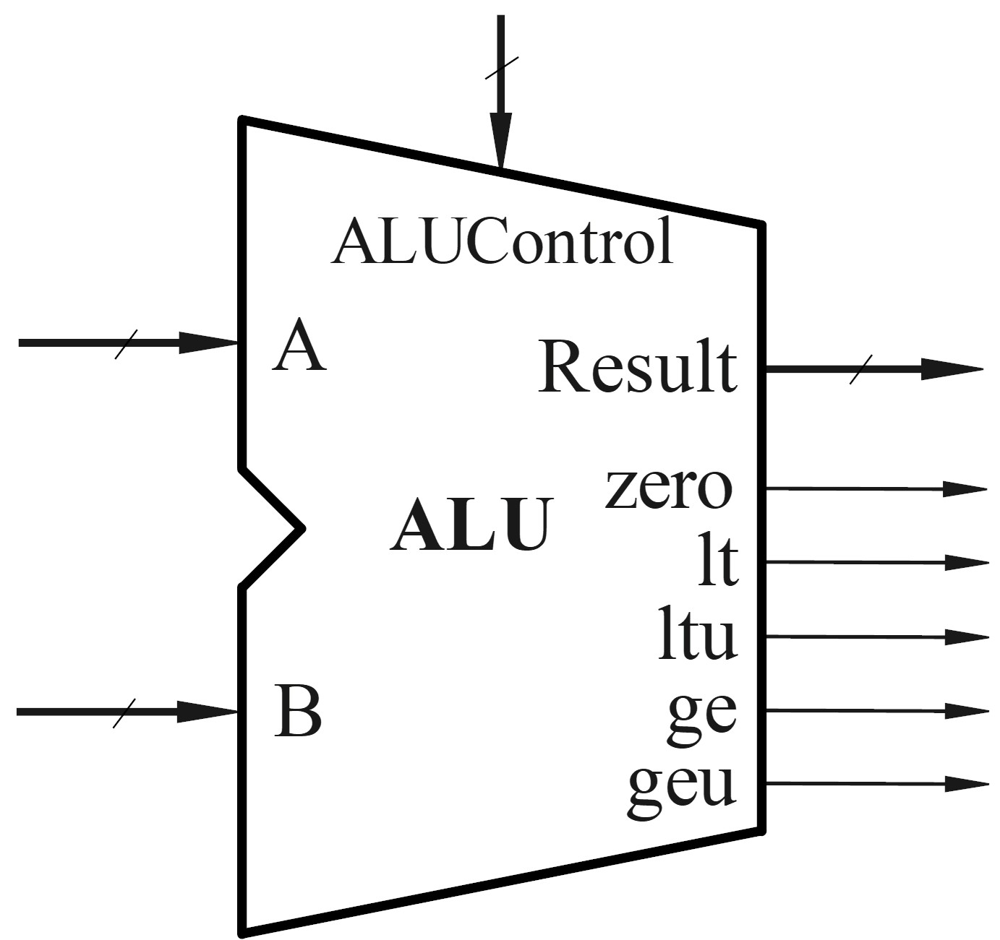
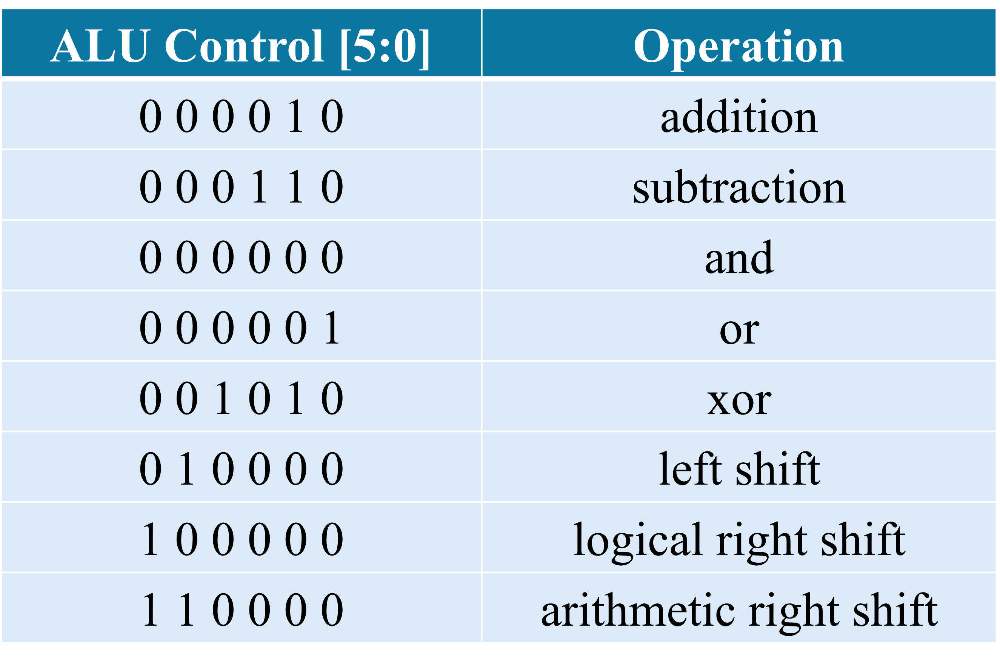
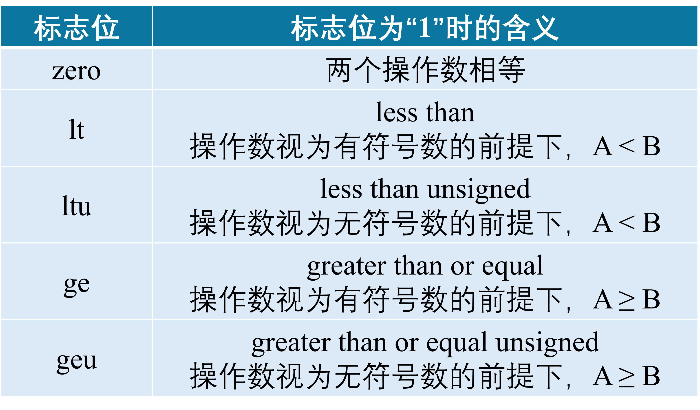
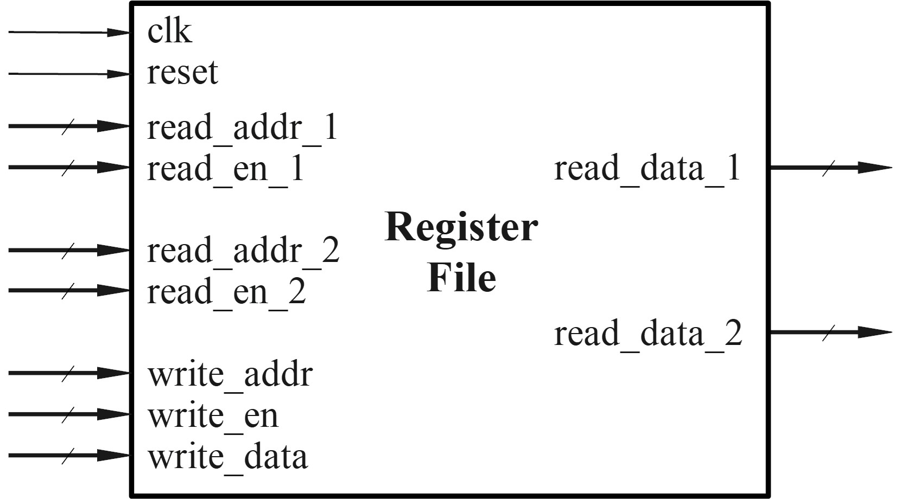
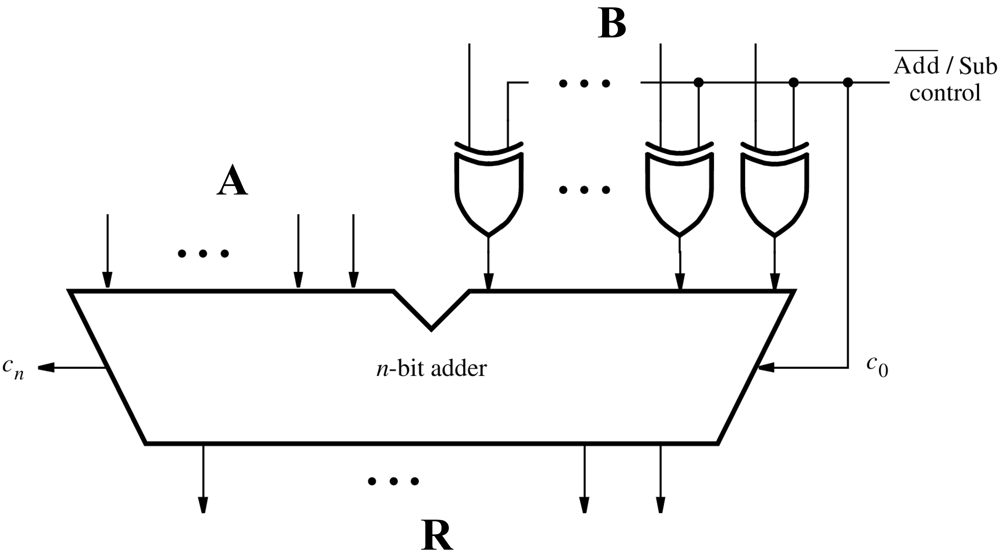

实验四 算术逻辑单元 ALU 与寄存器堆设计
========================

本实验中，我们将完成算术逻辑单元 (ALU) 和寄存器堆 (register file) 的设计与仿真，为后续的处理器设计奠定基础。

1. 电路模块功能描述
~~~~~~~~~~~~~~~~~~~~~~~~~~~~~~~~
ALU 功能描述
-------------------------------

我们要设计一个算术逻辑单元 (ALU)，输入输出如图所示：

A 和 B 是两个 32 位的输入操作数，Result 是 32 位的运算结果。具体做什么运算由 6 位的 ALUControl 决定，如表格所示。进行移位操作时，选择操作数 B 的后 5 位作为移位量。

此外，ALU 还需要对比两个输入操作数的数值大小，并输出相应的标志位，具体如下表：

寄存器堆功能描述
-------------------------------
本实验中，ALU 的操作数可以来自寄存器，也可以是立即数，因此需要设计寄存器堆 (Register file)。功能如下：

   * 寄存器堆中包含 32 个 32 位的寄存器，分别编址为 0 号 ~ 31 号；
   * 寄存器堆包含两路读出通路和一路写入通路，每一路都有使能信号、地址信号、数据信号。
   * 读出操作 **不受** ``clk`` 控制，只要读出使能信号 ``read_en`` 为 1，就将地址为 ``read_addr`` 的寄存器中的数据读出到数据输出端 ``read_data``；
   * 写入操作 **受** ``clk`` 控制，在时钟沿来临并且写入使能信号 ``write_en`` 为 1 时，将待写入的数据 ``write_data`` 写入地址为 ``write_addr`` 的寄存器中；
   * ``reset`` 信号可以将所有寄存器写为全零；
   * 第 0 号寄存器恒为全零。

2. 实验内容
~~~~~~~~~~~~~~~~~~~~~~~~~~~~~~~~
ALU 设计
-------------------------------
加、减、与、或、异或、移位操作的 verilog 实现比较简单，这里着重讨论如何基于减法的结果完成两个操作数的大小值判断。

减法运算在硬件上是可以基于加法运算实现的，如图。我们可以根据减法的结果以及两个输入操作数的最高位，来判断数值大小。

.. admonition:: 必做内容1：证明数值大小的判断逻辑
   :class: mytodo

   已知输入操作数 A、B、减法运算的输出进位 cout，判断 ``A < B`` 的逻辑为：

   * 对于无符号数，当 ``cout = 0`` 时， ``A < B``;
   * 对于有符号数，当 ``A[31] ^ B[31] ^ cout = 0`` 时， ``A < B``; 

   请证明以上逻辑是正确的。

.. admonition:: 必做内容2：ALU Verilog 代码设计
   :class: mytodo

   根据功能描述完成 ALU verilog 代码的设计。注意 **A \>= B** 的逻辑可以由 **A \< B** 的逻辑取反推出。

   下列代码中使用了一些宏定义，这些宏定义在 :download:`define.v (点击下载) <define.v>` 中定义，下载并添加到你的 project 中。宏定义可以将数据位宽、地址位宽、使能信号的高低等信息单独定义，使得可以在不修改主要源代码的情况下更方便地修改设计，例如将 32 位 ALU 的设计扩展位 64 位。

   .. code-block:: v
      :caption: ALU 代码框架
      :linenos:

      `include "define.v"
      
      module ALU(
         input wire  [`ALU_DATA_BW] input_A
         ,input wire [`ALU_DATA_BW] input_B
         ,input wire [5:0]          ALUctrl

         ,output reg [`ALU_DATA_BW] result
         ,output wire zero
         ,output wire lt
         ,output wire ltu
         ,output wire ge
         ,output wire geu
         );

         wire c_out;

         // Your codes should start from here.
         // ......
         // End of your codes.

      endmodule

   .. code-block:: v
      :caption: define.v
      :linenos:

      Macros in define.v: 

      `define RST_EN       1'b1
      `define ZERO32       32'h00000000

      `define ALU_DATA_BW  31:0
      `define IMM_BW       31:0

      `define REG_ADDR_BW  4:0
      `define REG_BW       31:0

.. raw:: html

   

      
 verilog 中变量的符号

      
verilog 语法中对变量的默认符号有规则约定。例如，在不加特殊声明的情况下，reg 类型的变量默认为无符号数，integer 类型的变量默认为有符号数。而运算结果的符号由所有操作数决定 —— 只要有一个操作数是无符号的，整个表达式就按无符号运算。

      
使用过程中，如有需要强制将变量视为无符号数或有符号数，可使用系统函数 “$signed”, “$unsigned” 进行。

   

寄存器堆设计
-------------------------------

.. admonition:: 必做内容3：寄存器堆 verilog 代码设计
   :class: mytodo

   根据功能描述完成寄存器堆的代码设计。regs 为 ``[0:31]`` 共 32 个寄存器组成的数组，每个寄存器有 ``[31:0]`` 位。

   .. code-block:: v
      :caption: ALU 代码框架
      :linenos:

      `include "define.v"
      
      module regfile (
         input    wire  clk   
         ,input   wire  rst   

         ,input   wire  [`REG_ADDR_BW] write_addr 
         ,input   wire  [`REG_BW]      write_data 
         ,input   wire                 wen   
         
         ,input   wire  [`REG_ADDR_BW] read_addr1
         ,output  wire  [`REG_BW]      read_data1
         ,input   wire                 read_en1  

         ,input   wire  [`REG_ADDR_BW] read_addr2
         ,output  wire  [`REG_BW]      read_data2
         ,input   wire                 read_en2  
      );
      
         reg  [31:0] regs [0:31];

         // Your codes should start from here.
         // ......
         // End of your codes.

      endmodule

Top 模块仿真
-------------------------------
新建 Top module，将寄存器堆和 ALU 连接起来，使得寄存器堆为 ALU 提供输入，如图。

ALU 的第一个操作数来自寄存器堆，第二个操作数可能来自寄存器堆或者是一个立即数 ``Imm`` ，选哪一路取决于 ``ALUSrc`` 的控制。

   .. figure:: ./pics/Registerfile_ALU_top.jpg
      :alt: Registerfile_ALU_top
      :align: center

.. admonition:: 必做内容4：Top 模块 testbench 仿真
   :class: mytodo
   
   以下为 top 模块示例。
   
   **注意**：不要修改输入输出信号名；实例化 ALU 时需要将实例命名为 ``u_ALU``；实例化 regfile 时需要将实例命名为 ``u_regfile``，以防 testbench 文件报错。

   .. code-block:: v
      :caption: Top 代码框架
      :linenos:

      `include "define.v"

      module Top (
         input    wire	clk   
         ,input   wire	rst   

         ,input   wire  [`REG_ADDR_BW] write_addr 
         ,input   wire                 wen          
         ,input   wire  [`REG_ADDR_BW] read_addr1
         ,input   wire                 read_en1  
         ,input   wire  [`REG_ADDR_BW] read_addr2
         ,input   wire                 read_en2

         ,input   wire              ALUSrc
         ,input   wire  [5:0]       ALUctrl
         ,input   wire  [`IMM_BW]   Imm 

         ,output  wire  [`ALU_DATA_BW] ALU_result
         ,output  wire  zero
         ,output  wire  lt
         ,output  wire  ltu
         ,output  wire  ge
         ,output  wire  geu
         );

         // Your codes should start from here.
         // ......
         // End of your codes.

      endmodule
   
      
   Testbench 文件需要对各种 ALU 操作和不同的寄存器读写进行测试，测试激励较为复杂，因此此处直接提供 testbench 文件：:download:`tb_top.v (点击下载) <tb_top.v>` 。完成 top 模块的测试，并对所有测试用例都通过测试的界面进行截图，示例如下。

   .. figure:: ./pics/pass.png
      :alt: pass
      :align: center
      :scale: 80

3. 报告提交
~~~~~~~~~~~~~~~~~~~~~~~~~~~~~~~~

本次实验需要提交：

   * 实验报告：:download:`下载实验报告模板 <Lab4_Report_26Fall.docx>` 
   * ``.v`` 文件压缩包：只设计文件，无需仿真文件

两项一同扫码提交（支持从微信聊天记录上传）。

.. raw:: html

   
Deadline ：<strong style="color: #d32f2f;">2026-11-01 23:59:59 </strong>。

