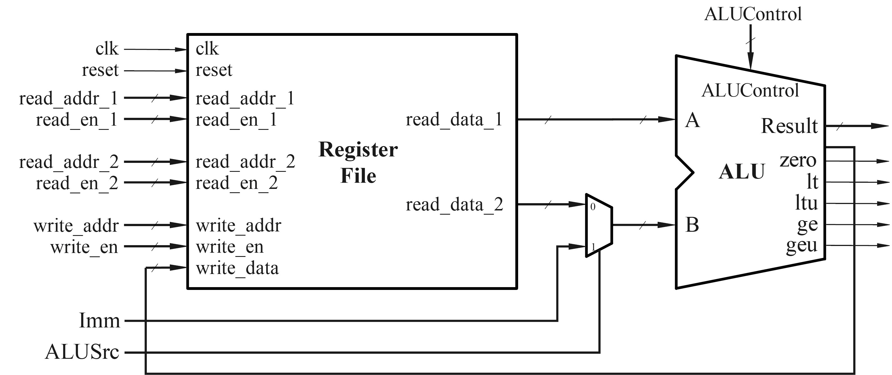

实验四 算术逻辑单元 ALU 与寄存器堆设计
========================

本实验中，我们将完成算术逻辑单元 (ALU) 和寄存器堆 (register file) 的设计与仿真，为后续的处理器设计奠定基础。

1. 电路模块功能描述
~~~~~~~~~~~~~~~~~~~~~~~~~~~~~~~~
ALU 功能描述
-------------------------------

我们要设计一个算术逻辑单元 (ALU)，输入输出如图所示：

.. figure:: ./pics/ALU.jpg
   :alt: ALU
   :align: center
   :scale: 20

A 和 B 是两个 32 位的输入操作数，Result 是 32 位的运算结果。具体做什么运算由 6 位的 ALUControl 决定，如表格所示：

.. figure:: ./pics/ALUoperation.png
   :alt: ALUOperation
   :align: center
   :scale: 18

此外，ALU 还需要对比两个输入操作数的数值大小，并输出相应的标志位，具体如下表：

.. figure:: ./pics/flagbits.png
   :alt: flagbits
   :align: center
   :scale: 18

寄存器堆功能描述
-------------------------------
本实验中，ALU 的操作数可以来自寄存器，也可以是立即数，因此需要设计寄存器堆 (Register file)。功能如下：

   * 寄存器堆中包含 32 个 32 位的寄存器，分别编址为 0 号 ~ 31 号；
   * 寄存器堆包含两路读出通路和一路写入通路，每一路都有使能信号、地址信号、数据信号。只有当使能信号为 “1” 时，才进行写入或读出操作。写入操作将输入数据 ``write_data`` 写入地址为 ``write_addr`` 的寄存器中去；读出操作将地址为 ``read_addr`` 的寄存器中的数据读出到数据输出端 ``read_data``；
   * 数据的存入和读出由时钟信号 ``clk`` 控制， ；
   * ``reset`` 信号可以将所有寄存器初始化为全零；
   * 第 0 号寄存器恒为全零。

.. figure:: ./pics/Registerfile.jpg
   :alt: Registerfile
   :align: center
   :scale: 30

Top 模块
-------------------------------
本实验中，我们将寄存器堆与 ALU 连接起来，使得寄存器堆为 ALU 提供输入，如图。

ALU 的第一个操作数来自寄存器堆，第二个操作数可能来自寄存器堆或者是一个立即数 ``Imm`` ，选哪一路取决于 ``ALUSrc`` 的控制。

2. 实验内容
~~~~~~~~~~~~~~~~~~~~~~~~~~~~~~~~
ALU 设计
-------------------------------
加、减、与、或、异或、移位操作的 verilog 实现比较简单，这里着重讨论如何基于减法的结果完成两个操作数的大小值判断。

减法运算在硬件上是可以基于加法运算实现的，如图。我们可以根据减法的结果以及两个输入操作数的最高位，来判断数值大小。

.. figure:: ./pics/subtractor.png
   :alt: subtractor
   :align: center
   :scale: 10

.. admonition:: 必做内容1：证明判断数值大小的逻辑
   :class: mytodo

   已知输入操作数 A、B、减法运算的输出进位 cout，判断 ``A < B`` 的逻辑为：

   * 对于无符号数，当 ``cout = 0`` 时， ``A < B``;
   * 对于有符号数，当 ``A[31] ^ B[31] ^ cout = 0`` 时， ``A < B``; 

   请证明以上逻辑是正确的。

.. admonition:: 必做内容2：Verilog 代码设计
   :class: mytodo

   根据功能描述完成 ALU verilog 代码的设计。注意 **A \>= B** 的逻辑可以由 **A \< B** 的逻辑取反推出。

    .. code-block:: v
        :caption: ALU 代码框架
        :linenos:

         module ALU(
            input wire [31:0] input_A
            ,input wire [31:0] input_B
            ,input wire [5:0]  ALUctrl

            ,output reg [31:0] result
            ,output wire zero
            ,output wire lt
            ,output wire ltu
            ,output wire ge
            ,output wire geu
            );

            wire c_out;

            // Your codes should start from here.
            // ......
            // End of your codes.

         endmodule

寄存器堆设计
-------------------------------

.. admonition:: 必做内容3：寄存器堆代码设计
   :class: mytodo

   根据功能描述完成寄存器堆的代码设计。regs 为 ``[0:31]`` 共 32 个寄存器组成的数组，每个寄存器有 ``[31:0]`` 位。

   .. code-block:: v
      :caption: ALU 代码框架
      :linenos:
      :emphasize-lines: 18

         module regfile (
            input    wire  clk   
            ,input   wire  rst   

            ,input   wire  [4:0]    write_addr 
            ,input   wire  [31:0]   write_data 
            ,input   wire  wen   
            
            ,input   wire  [4:0]    read_addr1
            ,output  wire  [31:0]   read_data1
            ,input   wire  read_en1  

            ,input   wire  [4:0]    read_addr2
            ,output  wire  [31:0]   read_data2
            ,input   wire  read_en2  
         );
         
            reg  [31:0] regs [0:31];

            // Your codes should start from here.
            // ......
            // End of your codes.

         endmodule

Top 模块仿真
-------------------------------
.. admonition:: 必做内容4：对 Top 模块进行testbench 仿真
   :class: mytodo

   新建 Top module，将寄存器堆和 ALU 连接起来。
   
   这里提供 testbench 文件：:download:`tb_ALU.v (点击下载) <Lab4_Report_26Fall.docx>` 。完成 top 模块的测试，并对 “所有 case 通过测试” 的界面进行截图。

   .. code-block:: v
      :caption: 交通灯fsm top
      :emphasize-lines: 10, 17
      :linenos:

      module Top (
         input    wire  clk   
         ,input   wire  rst   

         ,input   wire  [4:0]    waddr 
         ,input   wire  [31:0]   wdata 
         ,input   wire  wen   
         
         ,input   wire  [4:0]    raddr1
         ,output  wire  [31:0]   rdata1
         ,input   wire  ren1  

         ,input   wire  [4:0]	   raddr2
         ,output  wire  [31:0]   rdata2
         ,input   wire  ren2  
      );
      
         reg  [31:0] regs [0:31];

         // Your codes should start from here.
         // ......
         // End of your codes.

      endmodule

3. 报告提交
~~~~~~~~~~~~~~~~~~~~~~~~~~~~~~~~

本次实验需要提交：

   * 实验报告：:download:`下载实验报告模板 <Lab4_Report_26Fall.docx>` 
   * ``.v`` 文件压缩包：包含设计文件和仿真文件

两项一同扫码提交（支持从微信聊天记录上传）。

.. raw:: html

   
Deadline ：<strong style="color: #d32f2f;">2026-11-01 23:59:59 </strong>。

.. figure:: ./pics/FCMA203_26Fall_Lab4QR.png
   :alt: QRcode
   :scale: 50
   :align: center
