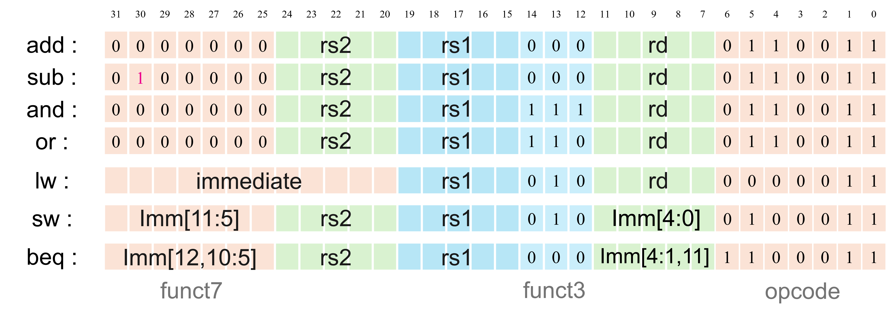
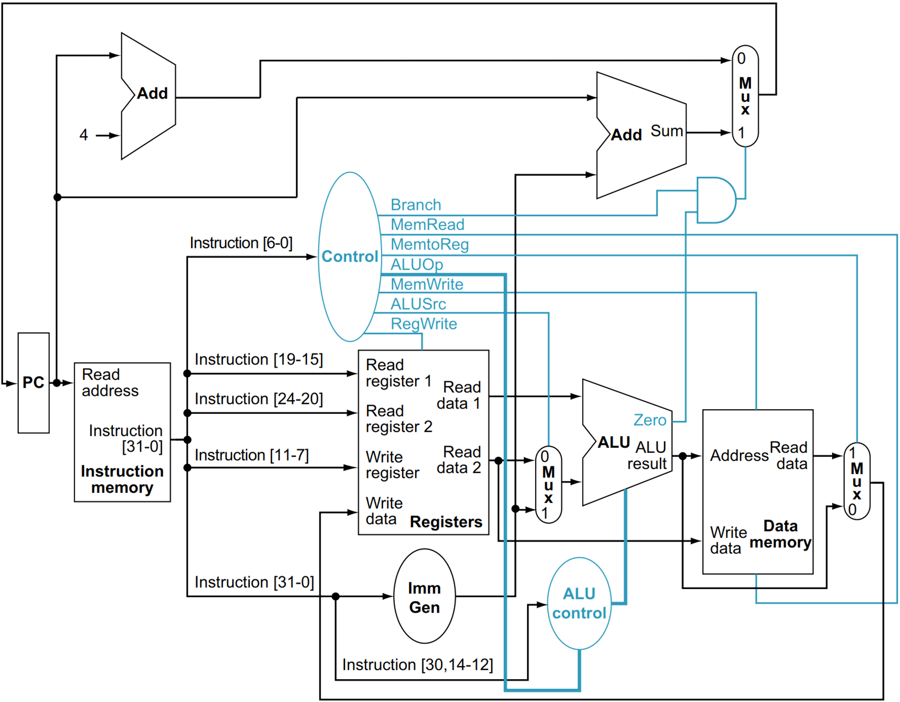

实验五 7 指令单周期 CPU 设计
========================

理论课堂上我们以 7 条指令为例，详细分析了 CPU 设计中需要关注的问题。本实验中，我们将设计这样一个简单的单周期 CPU，实现 RISC-V 中的 7 条指令，并通过仿真验证。

1. 待实现的 7 条 RISC-V 指令
~~~~~~~~~~~~~~~~~~~~~~~~~~~~~~~~
采用课堂讲述的 add, sub, and, or, lw, sw, beq 这 7 条 RISC-V 指令作为实现目标，指令的 32 位二进制表示的各字段如下图。

2. 实验内容
~~~~~~~~~~~~~~~~~~~~~~~~~~~~~~~~
单周期 CPU 设计
-------------------------------
课堂已详细讲解了单周期处理器设计各模块的功能，模块总框图如图。

ALU 和 register file 模块可使用实验四中你的设计。由于 7 条指令中没有移位指令，ALUctrl 的最高 2 bits 可以硬连为 0。
   
这里 **直接给出** 指令存储器 instruction memory 和数据存储器 data memory 的代码，:download:`下载 imem.v <sram.v>`，:download:`下载 dmem.v <sram.v>`，:download:`下载 sram.v <sram.v>`。注意不要修改模块名和端口名。

.. admonition:: 必做内容1：单周期 CPU verilog 代码设计
   :class: mytodo

   参考总框图完成剩余模块及 Top 模块的代码设计。
   
   Top 模块代码框架给出如下，请补充内部连线和模块例化。
   
   ``注意``：不要改变示例中给出的顶层名 cpu_top 以及 module 内部信号名，以防 testbench 中抓取信号时因找不到而报错。这些信号包括 input/output 信号名，pc、inst 等给出的内部连线，例化的寄存器堆实例的名字 u_regfile 和 数据存储器实例的名字 u_dmem。

   .. code-block:: v
      :caption: CPU top 代码框架
      :linenos:

      module cpu_top (
         input  wire        clk,
         input  wire        reset,     // 异步复位信号，高电平有效
         input  wire [31:0] start_pc   // 程序起始地址：复位后 PC 从该地址开始取指
      );

         //--------------------------------------------------------------------------
         // 给定的一部分内部连线
         //--------------------------------------------------------------------------
         wire [31:0] pc;             // 当前 PC
         wire [31:0] inst;           // 当前指令

         wire [31:0] read_data_1;    // 寄存器堆读口 1
         wire [31:0] read_data_2;    // 寄存器堆读口 2

         wire [31:0] imm;            // 立即数

         //--------------------------------------------------------------------------
         // 请补充其他内部连线
         // ......
         //--------------------------------------------------------------------------

         //--------------------------------------------------------------------------
         // 给定的一部分模块例化名，请补充信号对应关系
         //--------------------------------------------------------------------------
         regfile u_regfile (
            .clk            ()
            ,.rst           ()
            ,.write_addr    ()
            ,.write_data    ()
            ,.wen           ()
            ,.read_addr1    ()
            ,.read_data1    ()
            ,.read_en1      ()
            ,.read_addr2    ()
            ,.read_data2    ()
            ,.read_en2      ()
         );
         
         dmem u_dmem (
            .clk       ()
            ,.addr     ()
            ,.wdata    ()
            ,.write_en ()
            ,.rdata    ()
         );

         //--------------------------------------------------------------------------
         // 请补充其他模块例化
         // ......
         //--------------------------------------------------------------------------
         
      endmodule

单周期 CPU 仿真
-------------------------------
本次实验的 testbench 文件直接提供，:download:`tb_cpu_top_plan.sv (点击下载) <tb_cpu_top_plan.sv>` 。

为了对 CPU 指令执行的正确性进行测试，testbench 中需要在测试前对指令寄存器 imem 和数据寄存器 dmem 进行初始化，这个过程由 testbench 文件中的系统函数 ``$readmemh`` 完成。这个函数将十六进制表示的机器码内容从文件中读入到 memory 中。为指令存储器 imem 和数据存储器 dmem 准备的初始化机器码文件提供如下，:download:`imem.hex (点击下载) <imem.hex>` 和 :download:`dmem.hex (点击下载) <dmem.hex>`。请下载这两个 .hex 文件并以 simulation source 的途径添加到 project 中。

.. admonition:: 必做内容2：CPU testbench 仿真
   :class: mytodo

   完成 Top 模块的测试。

   如果对比结果有误，软件会在 Tcl Console 一栏内给出提示信息。如下图所示，dut 为待测试设计，也就是你的 Top 模块。提示信息将给出 dut 和 golden standard 的对比值，包括：pc 的对比、指令的十六进制表示和助记符形式、操作数的对比、寄存器值的对比等信息。请根据提示信息检查你的设计，找出 bug 并修正。

   .. figure:: ./pics/error.png
      :alt: error
      :align: center
      :scale: 70

   请 de 出所有的 bug，并对所有测试用例都通过的界面进行截图，示例如下。

   .. figure:: ./pics/pass.png
      :alt: pass
      :align: center
      :scale: 80

3. 报告提交
~~~~~~~~~~~~~~~~~~~~~~~~~~~~~~~~

本次实验需要提交：

   * 实验报告：:download:`下载实验报告模板 <Lab5_Report_26Fall.docx>` 
   * ``.v`` 文件压缩包：只需设计文件，无需仿真文件

两项一同扫码提交（支持从微信聊天记录上传）。

.. raw:: html

   
Deadline ：<strong style="color: #d32f2f;">2026-11-15 23:59:59 </strong>。

