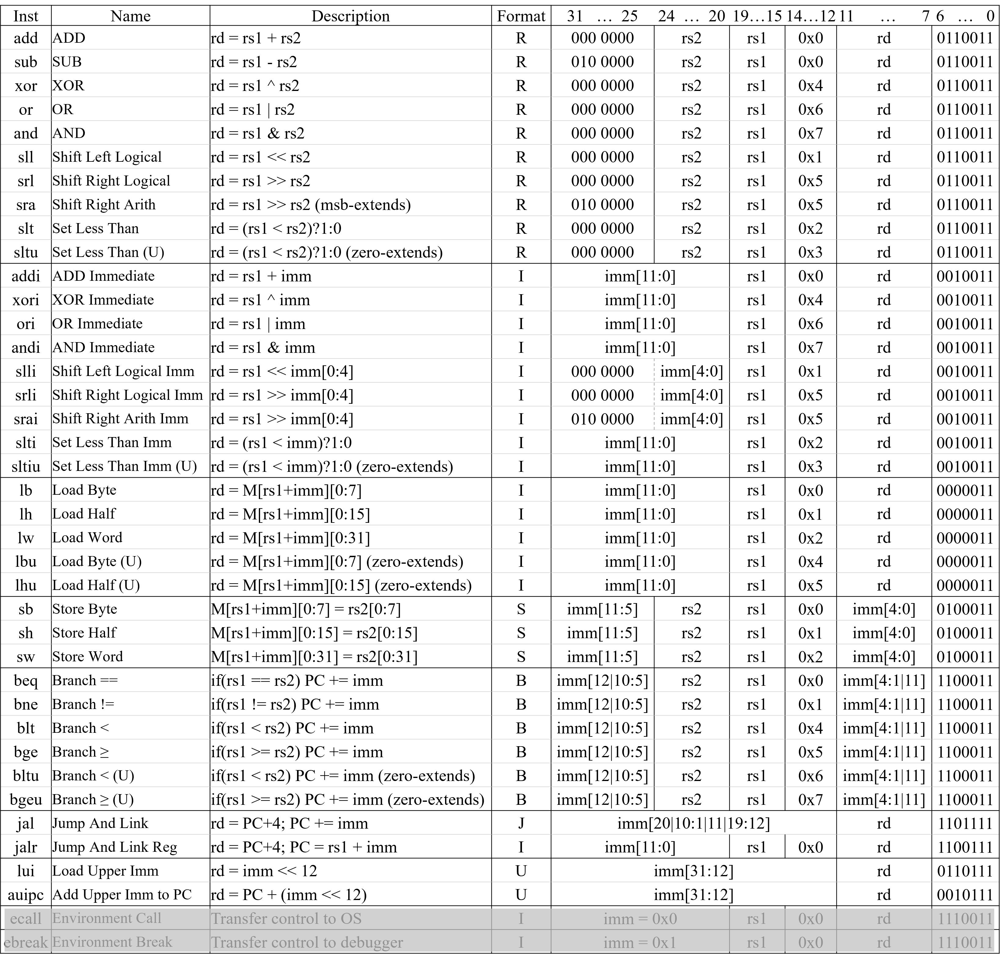
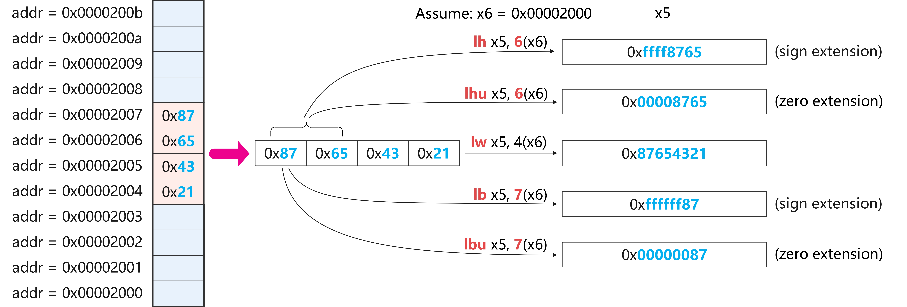

实验六 RV32I 全指令单周期 CPU 设计
========================

在实验五中设计的单周期 CPU 的基础上，我们将在本实验中完善指令集，实现 RV32I 集中的大部分指令，并通过仿真验证。

1. 待实现的 RV32I 指令
~~~~~~~~~~~~~~~~~~~~~~~~~~~~~~~~
待实现的 RV32I 指令如下图，最后两行的 ecall 和 ebreak 指令除外。

如果需要查看各指令的详细描述，请参考 RISC-V 指令集手册，手册在 git 仓库中已提供，这里再次提供下载链接：:download:`下载 The RISC-V Instruction Set Manual_20260120.pdf <The RISC-V Instruction Set Manual_20260120.pdf>`。文档比较长，可以用 Ctrl+F 搜索指令助记符，找到对应的指令描述。

一部分指令的实现方式与上次实验中的数据通路非常类似，例如 sll 、srl、sra 等指令的实现方式与 add、sub、and、or 指令类似，只是 ALUctrl 的值不同。

但以下几类指令的实现需要 **新增** 数据通路，必须理解指令功能，因此特别说明。

slt | sltu | slti | slitu 指令 
-------------------------------
slt 和 sltu 指令将寄存器 rs1 和 rs2 的值分别视为有符号和无符号数，并进行比较。如果 rs1 < rs2， rd = 1，否则 rd = 0。

slti 和 sltiu 指令将寄存器 rs1 的值和立即数 imm 的值分别视为有符号和无符号数，并进行比较。如果 rs1 < imm， rd = 1，否则 rd = 0。

前序实验的 ALU 设计中已经完成比较功能并输出了 lt 和 ltu 标志位。   这两个标志位可以直接作为 slt、sltu、slti、sltiu 指令的判断依据。只需要在 ALU 模块中增加将 ALU 的输出值 set 为 1 或 0 的功能即可。

lw | lb | lh | lbu | lhu 指令 
-------------------------------
实验五中已经把 dmem, imem, 以及存储核心模块 sram 提供给大家，sram 代码如下。本次需要考虑到 load 指令的 **字节对齐** 问题。

代码中所示的 dmem 模块中地址 addr 是按 byte 寻址的，但是核心存储模块 sram 的地址 ADDR 是按 word 对齐的。因此 dmem 在调用 sram 时，需要把地址 addr 的低两位去掉，取 ``addr[15:2]`` 作为 sram 的地址 ADDR 进行读写操作。

.. code-block:: v
   :caption: dmem 和 sram 代码
   :emphasize-lines: 11, 13
   :linenos:

   module dmem (
      input  wire        clk,
      input  wire [31:0] addr,
      input  wire [31:0] wdata,
      input  wire        write_en,
      output wire [31:0] rdata
   );
      
      sram #(.AW(14)) u_sram (
         .CLK   (clk),
         .ADDR  (addr[15:2]),       // 字节地址 -> 字地址：取 addr[15:2]
         .WDATA (wdata),
         .WREN  ({4{write_en}}),    // sw 为全字写：4 个字节写使能同时有效
         .RDATA (rdata)
      );

   endmodule
   
   module sram #( parameter AW = 14) (
      input  wire           CLK
      ,input  wire [AW-1:0] ADDR
      ,input  wire [31:0]   WDATA
      ,input  wire [3:0]    WREN
      ,output wire [31:0]   RDATA
   );
      localparam AWT = ((1<<(AW-0))-1);

      // Memory Array
      reg     [31:0]  sram [AWT:0];

      // Write, byte-based enable, synchronous
      always@(posedge CLK) begin
         if(WREN[0]) sram[ADDR][ 7:0] <= WDATA[ 7:0];
      end
      always@(posedge CLK) begin
         if(WREN[1]) sram[ADDR][15:8] <= WDATA[15:8];
      end
      always@(posedge CLK) begin
         if(WREN[2]) sram[ADDR][23:16] <= WDATA[23:16];
      end
      always@(posedge CLK) begin
         if(WREN[3]) sram[ADDR][31:24] <= WDATA[31:24];
      end

      // Read, word based, asynchronous
      assign RDATA = sram[ADDR];

   endmodule

由于 sram 地址是 word 对齐的，所以读操作每次只能返回一个完整的 32-bit 的 word，而不能返回一个单独的 byte 或 half word。因此在实现 lb、lh、lbu、lhu 指令时，需要在读出来的 32-bit word 中根据地址的低两位 ``addr[1:0]`` 选择对应的 byte 或 half word，并根据指令类型进行符号扩展或零扩展，如图所示。这部分是需要你自行在 dmem 模块中 **补充** 完成的。

sw | sh | sb 指令 
-------------------------------
sw 的功能实验五中已经实现，难点是 sb 和 sh 指令的 **字节对齐** 问题。

sb 只取寄存器 rs2 值的低 8 位数值进行写入，sh 取 rs2 值的低 16 位数值进行写入。这种只写入一部分值的操作在 sram 模块中已经实现了，即用 WREN 信号的 [3:0] 位分别对 4 个字节进行写使能控制。因此在 dmem 中需要根据指令类型和地址的低两位 ``addr[1:0]`` 改变 WREN 的值，从而对 4 个字节分别进行写入控制。这部分是需要你自行在 dmem 模块中 **补充** 完成的。

jal | jalr 指令 
-------------------------------
jal 和 jalr 指令需要进行跳转，因此需要在 CPU 中 **添加** PC 的更新逻辑。另外，这两条指令的 rd 寄存器需要写入 PC + 4 的值，作为返回地址，这个逻辑也需要 **补充**。

跳转地址必须是 2 的倍数，也是需要重点考虑的问题。jal 指令的跳转地址是 PC + imm，PC 和 J 型指令的 imm 字段都保证了跳转地址是 2 的倍数；jalr 指令的情况更复杂，其跳转地址是 rs1 + imm，而 I 型指令的 imm 字段并没有特殊处理。因此需要将 jalr 的跳转地址的 **最低位强制置为 0**，以保证跳转地址是 2 的倍数，这一点需要你在代码中进行设置。

2. 实验内容
~~~~~~~~~~~~~~~~~~~~~~~~~~~~~~~~
单周期 CPU 设计
-------------------------------

.. admonition:: 必做内容1：单周期 CPU 数据通路设计 
   :class: mytodo

   参考实验五中 7 条指令的数据通路设计，画出本次实验的单周期 CPU 数据通路图。

.. admonition:: 必做内容2：单周期 CPU verilog 代码设计
   :class: mytodo

   根据你画出的数据通路图，完成单周期 CPU 的 verilog 代码设计。为了防止 testbench 中抓取信号时因找不到而报错，请按以下规则设计：

   * 顶层 module 名为 "single_cycle_cpu"
   * 顶层 module 有三个端口 "clk"、"reset"、"[31:0] start_pc"。
   * reset 为同步复位、高有效，reset 后 PC = start_pc
   * 顶层存在 5 个 wire 变量，名字为："pc"、"inst"、"read_data_1"、"read_data_2"、"imm"
   * 寄存器堆例化的实例名为 u_regfile，regfile 模块内必须包含名为 regs 的结构（32 × 32bit）
   * 数据 memory 例化的实例名为 u_dmem，dmem 模块内必须包含名为 sram 的结构（16K × 32bit）
   * sram 读操作为组合逻辑、写操作在 clk 上升沿触发 （实验五中给出的 sram 模块已完成该功能）；
   * 除 clk 上升沿外无其他时钟沿触发状态更新 
  

单周期 CPU 仿真
-------------------------------
本次实验的 testbench 文件直接提供，:download:`tb_single_cycle_cpu.sv (点击下载) <tb_single_cycle_cpu.sv>` 。

与实验五类似，testbench 中需要在测试前用系统函数 ``$readmemh`` 对指令寄存器 imem 和数据寄存器 dmem 进行初始化。为指令存储器 imem 和数据存储器 dmem 准备的初始化机器码文件提供如下，:download:`imem.hex (点击下载) <imem.hex>` 和 :download:`dmem.hex (点击下载) <dmem.hex>`。请下载这两个 .hex 文件并以 simulation source 的途径添加到 project 中。

.. admonition:: 必做内容3：CPU testbench 仿真
   :class: mytodo

   完成 Top 模块的测试。

   如果对比结果有误，软件会在 Tcl Console 一栏内给出提示信息。如下图所示，dut 为待测试设计，也就是你的 Top 模块。提示信息将给出 dut 和 golden standard 的对比值，包括：pc 的对比、指令的十六进制表示和助记符形式、操作数的对比、寄存器值的对比等信息。请根据提示信息检查你的设计，找出 bug 并修正。

   .. figure:: ./pics/error.png
      :alt: error
      :align: center
      :scale: 70

   请 de 出所有的 bug，并对所有测试用例都通过的界面进行截图，示例如下。

   .. figure:: ./pics/pass.png
      :alt: pass
      :align: center
      :scale: 80

3. 报告提交
~~~~~~~~~~~~~~~~~~~~~~~~~~~~~~~~

本次实验需要提交：

   * 实验报告：:download:`下载实验报告模板 <Lab6_Report_26Fall.docx>` 
   * ``.v`` 文件压缩包：只需设计文件，无需仿真文件

两项一同扫码提交（支持从微信聊天记录上传）。

.. raw:: html

   
Deadline ：<strong style="color: #d32f2f;">2026-11-29 23:59:59 </strong>。

